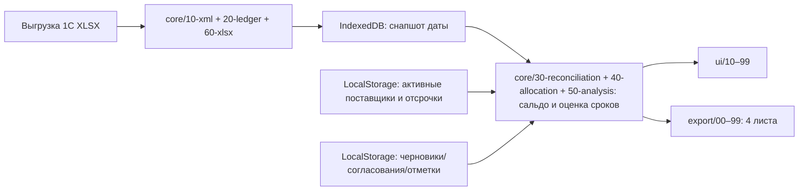

# Архитектура

## Поток данных

### Основные принципы

1. **Разделение предметных слоёв:** Core не знает DOM/IndexedDB; UI не реализует формулы.
2. **Идентификатор поставщика:** нормализованные наименования организации и контрагента в паре. Это не юридически надёжный ключ; будущий релиз должен использовать стабильные ID/ИНН, проверенные вручную.
3. **Денежные значения:** integer копейки в JS SafeInteger пределах. Промежуточная арифметика без округления float.
4. **Календарный срок:** дата входящего документа + N календарных дней; дата отчёта задаётся явно.
5. **Снимки:** каждое состояние 1С — самостоятельный срез. Локальное подтверждение не заменяет факт из следующей выгрузки.
6. **Ревизии:** смена хэша файла за тот же день требует подтверждения; ранее сделанные ручные решения должны проходить повторную сверку.

### Безопасность и развитие

Текущий прототип **не имеет авторизации**. Для корпоративного развёртывания потребуются роли (инициатор/согласующий/бухгалтер), серверная проверка суммы, журнал неизменяемых событий, RLS и резервное копирование. Никогда не публикуйте заполненные отчёты 1С в репозитории.

Следующие инженерные задачи: добавить ссылки зачёта из 1С, строгую привязку контрагентов по ID/ИНН, автоматические сверки между срезами, тесты на больших XLSX и multiuser backend.

## Компоновка

`npm run build` собирает функциональные группы `src/core`, `src/export`, `src/ui` в отдельные браузерные скрипты `dist/assets/core.js`, `export.js`, `ui.js`. Это **не** один монолитный файл; функции предметной логики отдельно от интерфейса, хотя внутри группы сейчас используется общий lexical scope — временный совместимый шаг миграции.

В следующий технический этап можно заменить срезы групп на настоящие ESM `import/export`, тогда же усилить типизацию и тесты.
